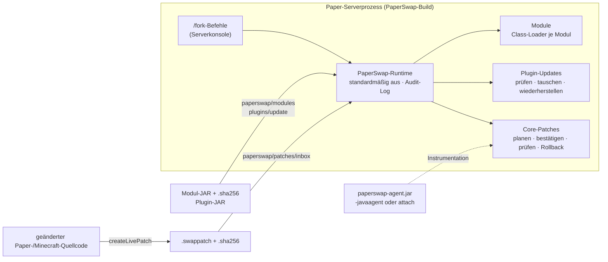

<p align="center">
  
</p>

<p align="center">
  <a href="https://github.com/luckyluci1026-stack/LemonPvP/actions/workflows/paperswap-ci.yml"></a>
  
  
  <a href="LICENSE"></a>
  
</p>

<p align="center">
  <a href="README.md">English</a> · <b>Deutsch</b>
</p>

---

**PaperSwap** ist eine Fork von [Paper](https://papermc.io) für Minecraft: Java Edition, die einen
**laufenden** Server ändern kann – eigene Module, normale Bukkit-Plugins und sogar Code von Paper
und Minecraft selbst – ohne Neustart, **dort, wo JVM und Server das tatsächlich sicher können**. Wo
nicht, sagt PaperSwap das und verlangt einen Neustart, statt Erfolg vorzutäuschen.

Ohne Konfiguration ist es einfach Paper: Die Runtime ist **standardmäßig aus**, öffnet **keinen
Netzwerkport** und tut nichts, bis du sie einschaltest.


### Das ist Swappie

**Swappie** ist unser Maskottchen: ein Blatt Papier zwischen zwei Tausch-Pfeilen – genau wie der
Code auf deinem Server. Swappie tauscht für sein Leben gern, prüft aber immer vorher und hält die
alte Version griffbereit.

## Highlights

- 🔁 **Module im laufenden Betrieb tauschen** – Erweiterungen laden, aktivieren, ersetzen und
  entfernen, jede in einem eigenen Class-Loader. Schlägt ein Tausch fehl, läuft wieder die alte
  Version; Listener, Tasks, Befehle und Services werden erfasst und freigegeben, nicht eingesammelte
  Class-Loader werden gemeldet.
- 🔌 **Live-Updates für Plugins** – jedes Bukkit-Plugin-Update wird zuerst geprüft (Deskriptor,
  Hauptklasse, Klassenversionen, Abhängigkeiten, Paper-Plugins, Lifecycle-API). Nur was besteht,
  wird live getauscht, alles andere bekommt ein klares *Neustart nötig*. Die vorherige JAR lässt
  sich wiederherstellen.
- 🧬 **Core-Patches** – eine Methode im Paper-/Minecraft-Quellcode ändern, mit Gradle ein
  `.swappatch`-Archiv (mit SHA-256-Datei) bauen und über `java.lang.instrument` auf den laufenden
  Server anwenden. Jeder Patch wird geplant, an der Konsole bestätigt, **aus der laufenden JVM
  zurückgelesen** und kann zurückgenommen werden.
- 🔬 **Instrumentation-Werkzeuge** – Agent beim Start laden oder nachträglich an einen laufenden
  Server anhängen, die ~30 000 geladenen Klassen durchsuchen, eine Klasse untersuchen
  (Code-Source, SHA-256, änderbar?) und zwischen Redefinition und kontrollierter
  Retransformation wählen.
- 🛡️ **Sicher als Standard** – alles, was Code ändert, ist aus, bis es in der Konfiguration
  eingeschaltet wird, und nur an der Serverkonsole erlaubt; Live-Updates brauchen ein
  ausdrückliches `confirm`, Aktionen landen im Audit-Log. Produktionsprofil: nur freigegebene Patches; Module und Patches brauchen eine
  passende SHA-256-Datei.
- 🧪 **Auf echten Servern getestet** – jeder CI-Lauf baut alle vier Versionen, führt Papers eigene
  Testsuite aus, startet dann jeden Server und bedient ihn über die Konsole in bis zu zehn
  Testszenarien.

## Was PaperSwap kann – und was nicht

| | Was | Wie | Grenze |
|---|---|---|---|
| **Module** | Erweiterungen mit der PaperSwap-API | eigener Class-Loader, Hot-Swap mit Rollback | kein JVM-Hot-Swap: die Modulinstanz wird ersetzt |
| **Plugins** | normale Paper/Bukkit-Plugins | Kompatibilitätsprüfung → entladen → neue JAR laden → bei Fehler wiederherstellen | Paper-Plugins, Plugins mit Lifecycle-API oder aktiven Abhängigen: nur Neustart |
| **Core-Patches** | Klassen von Paper, Minecraft und PaperSwap | JVM-Redefinition / Retransformation über `paperswap-agent.jar` | Standard-JVMs: **nur Methodenrümpfe**; strukturelle Änderungen brauchen JetBrains Runtime + `-XX:+AllowEnhancedClassRedefinition` |

> [!IMPORTANT]
> Es gibt **kein universelles Live-Patching**. Ein Rollback stellt **Klassendefinitionen** wieder
> her, nicht den Serverzustand: Objekte, statische Felder, Caches, Threads und alles, was ein Patch
> bereits getan hat, bleiben, wie sie sind. Statische Initialisierer laufen nicht erneut.
> Details: [`docs/LIMITATIONS.md`](docs/LIMITATIONS.md).

## Wie es funktioniert



Die Fork selbst ändert an Paper sehr wenig: drei einzeilige Hooks in `CraftServer` (nach dem
Aktivieren der Plugins, vor dem Deaktivieren, vor `/reload`), die Runtime-Klassen unter
`dev.paperswap.runtime.*`, die Server-Marke und zwei Gradle-Tasks für Core-Patches. Keine
Änderungen am Tick-Ablauf, am Netzwerk oder an Paper-Befehlen. Bei ausgeschalteter Runtime lesen
die Hooks nur eine Konfigurationsdatei.

## Unterstützte Versionen

| Minecraft | Paper-Upstream | JDK | Status |
|---|---|---|---|
| 1.21.11 | `ver/1.21.11` @ `c5eb079` | 21 | unterstützt |
| 26.1.2 (Linie 26.1) | `ver/26.1.2` @ `e4e17fc` | 25 | unterstützt |
| 26.2 | `ver/26.2` @ `58e6e45` | 25 | unterstützt |
| 26.3 | `main` @ `6829d9e` (kein Paper-Release-Tag) | 25 | in Arbeit |

Jede Version ist ein eigenes Build-Artefakt – es gibt keine „Universal-JAR“. Folia wird nicht
unterstützt. Details: [`docs/VERSIONS.md`](docs/VERSIONS.md).

## Schnellstart

### 1. Server bauen

```bash
cd versions/26.2                                   # bzw. 1.21.11, 26.1.2, 26.3
./gradlew applyAllPatches build createPaperclipJar # 1.21.11: createMojmapPaperclipJar
java -jar paperswap-server/build/libs/*paperclip*.jar --nogui
```

Voraussetzungen (JDK, Netzwerkzugriffe, Git-Identität): [`docs/BUILDING.md`](docs/BUILDING.md).
CI-Builds gibt es als Workflow-Artefakte (`Actions → PaperSwap CI → paperswap-<version>`).

### 2. Runtime einschalten

`config/paperswap.yml` entsteht beim ersten Start mit `enabled: false`:

```yaml
enabled: true
allow-runtime-deploy: true   # nur auf Test-/Entwicklungsservern dauerhaft
```

Server einmal neu starten.

### 3. Ein Modul tauschen

```bash
cp example-greeter.jar example-greeter.jar.sha256 paperswap/modules/
```

```text
fork module list
fork module enable example-greeter
fork module reload example-greeter      # Hot-Swap mit Rollback
fork module config example-greeter      # Konfiguration neu laden
fork module diagnostics example-greeter # Tasks, Listener, alte Class-Loader
fork module disable example-greeter
```

### 4. Live-Updates für Plugins und Core-Code

```text
fork live status                      # was ist erlaubt, was ist aktiv
fork live scan                        # was liegt bereit (Module, plugins/update, patches/inbox)
fork live check <name>                # live möglich? (ändert nichts)
fork live update <name>               # Plan anzeigen …
fork live update <name> confirm       # … und ausführen
fork live rollback <name> [confirm]   # vorherige Plugin-JAR / Bytecode vor dem Patch
fork live patch verify <id>           # laufenden Bytecode zurücklesen und vergleichen
fork instrumentation status           # Agent, JVM-Fähigkeiten, Warnungen (z. B. offener JDWP-Port)
fork instrumentation classes <filter> # geladene Klassen durchsuchen
```

Plugin-Updates und Core-Patches haben eigene Schalter (`plugin-updates.enabled`,
`live-patching.enabled`). Core-Patches brauchen den Agenten:
`java -javaagent:paperswap-agent.jar -jar server.jar` oder, auf einem Entwicklungsserver,
`java -jar paperswap-agent.jar attach <pid>` (lokaler Attach-Mechanismus des JDK, nur derselbe
Betriebssystem-Benutzer, kein Netzwerkport). Schritt-für-Schritt-Anleitungen:
[`docs/LIVE-UPDATES.md`](docs/LIVE-UPDATES.md), [`docs/INSTRUMENTATION.md`](docs/INSTRUMENTATION.md).

## Sicher als Standard

| Standard | Warum |
|---|---|
| Runtime `enabled: false` | ein PaperSwap-Build verhält sich wie Paper, bis du es einschaltest |
| `allow-runtime-deploy: false` | Module starten nur mit dem Server, solange Laufzeitänderungen nicht erlaubt sind |
| `paperswap.module.manage`, `paperswap.live.update` haben den Default **niemand** | Code ändernde Befehle nur an der Serverkonsole (RCON ist nicht die Konsole) |
| jedes Live-Update = Plan → `confirm` | bestätigt wird genau der geprüfte SHA-256-Stand |
| keine Ordnerüberwachung, kein Autoload, keine Downloads | Neues läuft nur, wenn jemand es ausdrücklich anfordert |
| kein Netzwerkport | der Agent nutzt den lokalen Attach-Socket des JDK; ein offener JDWP-Port wird als Warnung gemeldet |
| Produktionsprofil für Patches | nur freigegebene Patches; das Entwicklungsprofil braucht `-Dpaperswap.livepatch.development=true` |

Ein Hash oder eine Allow-List macht bösartigen Code nicht sicher, und Class-Loader-Isolation ist
keine Sandbox: Wer in `paperswap/modules/` schreiben darf, hat praktisch Shell-Zugriff.
Bedrohungsmodell und Empfehlungen: [`docs/SECURITY.md`](docs/SECURITY.md).

## Tests

PaperSwap trennt drei Testebenen und vermischt sie in Berichten nie:

| Ebene | Was läuft | Wo |
|---|---|---|
| **Unit- und Integrationstests** | Runtime-Kern mit echten, zur Testzeit kompilierten Modul-JARs, echten Class-Loadern, dem echten Agenten (`-javaagent`) und einem Attach-Test mit zwei JVM-Prozessen | Temurin 21 und JetBrains Runtime 21/25 |
| **Paper-Build** | `applyAllPatches` + `build` führt **Papers eigene Testsuite** gegen den PaperSwap-Server aus | alle vier Versionen |
| **Live-Server-Tests** | die gebaute Paperclip-JAR wird gestartet, über die Konsole bedient und gestoppt: Runtime aus/an/Neustart, Modul-Lebenszyklus, Testmodule (Last, Fehler, Lecks), PvP-Suite, Core-Patches, Plugin-Updates, strukturelle Patches auf JetBrains Runtime, Attach + Retransformation | alle vier Versionen |

(Noch) nicht automatisiert: echte Spielerverbindungen, Lasttests mit Spielern,
Proxys/ViaVersion/Geyser, Windows/macOS. Protokolle aller relevanten CI-Läufe:
[`docs/TESTING.md`](docs/TESTING.md).

## Dokumentation

| Thema | Datei |
|---|---|
| Live-Updates: Module, Plugins, Core-Patches, Workflow IntelliJ → Server | [`docs/LIVE-UPDATES.md`](docs/LIVE-UPDATES.md) |
| JVM-Instrumentation: Agent beim Start oder per Attach, Klassensuche, Redefinition vs. Retransformation | [`docs/INSTRUMENTATION.md`](docs/INSTRUMENTATION.md) |
| Hot-Deployment: Architektur, Abläufe, Konfiguration, Befehle | [`docs/HOT-DEPLOYMENT.md`](docs/HOT-DEPLOYMENT.md) |
| Modulformat und Modulentwicklung | [`docs/MODULE-FORMAT.md`](docs/MODULE-FORMAT.md) |
| Was einen Neustart braucht | [`docs/RESTART-REQUIREMENTS.md`](docs/RESTART-REQUIREMENTS.md) |
| Bekannte Einschränkungen | [`docs/LIMITATIONS.md`](docs/LIMITATIONS.md) |
| Sicherheit | [`docs/SECURITY.md`](docs/SECURITY.md) |
| Fork bauen | [`docs/BUILDING.md`](docs/BUILDING.md) |
| Versionsmatrix | [`docs/VERSIONS.md`](docs/VERSIONS.md) |
| Upstream-Synchronisierung, neue Versionen | [`docs/UPSTREAM-SYNC.md`](docs/UPSTREAM-SYNC.md) |
| Testmodule (Last, Fehler, Abhängigkeiten, Lecks) | [`docs/TEST-MODULES.md`](docs/TEST-MODULES.md) |
| LemonPvP-Suite: Statistiken, Combat-Tag, Killstreaks, Scoreboard (Beispielmodule) | [`docs/PVP-SUITE.md`](docs/PVP-SUITE.md) |
| Speer-Angriffs-Cooldown 1.21.11, als Live-Patch angewendet | [`docs/SPEAR-COOLDOWN.md`](docs/SPEAR-COOLDOWN.md) |
| Kompatibilität (Proxy, ViaVersion, Geyser …) | [`docs/COMPATIBILITY.md`](docs/COMPATIBILITY.md) |
| Troubleshooting | [`docs/TROUBLESHOOTING.md`](docs/TROUBLESHOOTING.md) |
| Tests und Ergebnisse | [`docs/TESTING.md`](docs/TESTING.md) |
| Performance-Messungen | [`docs/PERFORMANCE.md`](docs/PERFORMANCE.md) |
| Umstieg vom alten Namen „Lemon“ | [`docs/MIGRATION.md`](docs/MIGRATION.md) |
| Analyse (Phase 1), verifizierte Versionen, Risiken | [`docs/ANALYSIS.md`](docs/ANALYSIS.md) |
| Beispiele (Konfigurationen, Deskriptor, Allow-List) | [`docs/examples/`](docs/examples) |

## Repository-Struktur

```text
runtime/            Runtime (API, Kern, Paper-Adapter, Agent, Beispielmodul, Testmodule, PvP-Suite) – eine Codebasis für alle Versionen
versions/<mc>/      Paperweight-Fork je Minecraft-Version (gepinnter Paper-Commit + PaperSwap-Patches)
scripts/fork/       Generatoren für Versionsprojekte und Patches
scripts/livepatch/  Gradle-Tasks für Core-Patches (in jeden Server-Build eingebunden)
scripts/ci/         Live-Server-Tests und CI-Hilfen
docs/               Dokumentation
assets/             Logo, Maskottchen Swappie, Banner, Social-Preview
index.html, index.zip   Website-Dateien des LemonPvP-Servers (nicht Teil der Fork)
```

## Mitmachen

Fehlerberichte, Ideen, Übersetzungen und Pull Requests sind willkommen. Bitte vorher
[`CONTRIBUTING.md`](CONTRIBUTING.md) und den [Verhaltenskodex](CODE_OF_CONDUCT.md) lesen.
Sicherheitsprobleme bitte vertraulich melden, siehe [`SECURITY.md`](SECURITY.md).

## Lizenz und Hinweis

PaperSwap steht unter der **GNU General Public License v3.0** – siehe [`LICENSE`](LICENSE) und
[`NOTICE.md`](NOTICE.md) (Teile von Paper stehen unter MIT, siehe [`licenses/`](licenses)).

PaperSwap ist **kein offizielles Paper-Projekt** und steht in keiner Verbindung zu PaperMC, Mojang
Studios oder Microsoft. „Minecraft“ ist eine Marke von Mojang Studios. Danke an das
[PaperMC](https://github.com/PaperMC)-Team für Paper und paperweight und an JetBrains für die
[JetBrains Runtime](https://github.com/JetBrains/JetBrainsRuntime).
