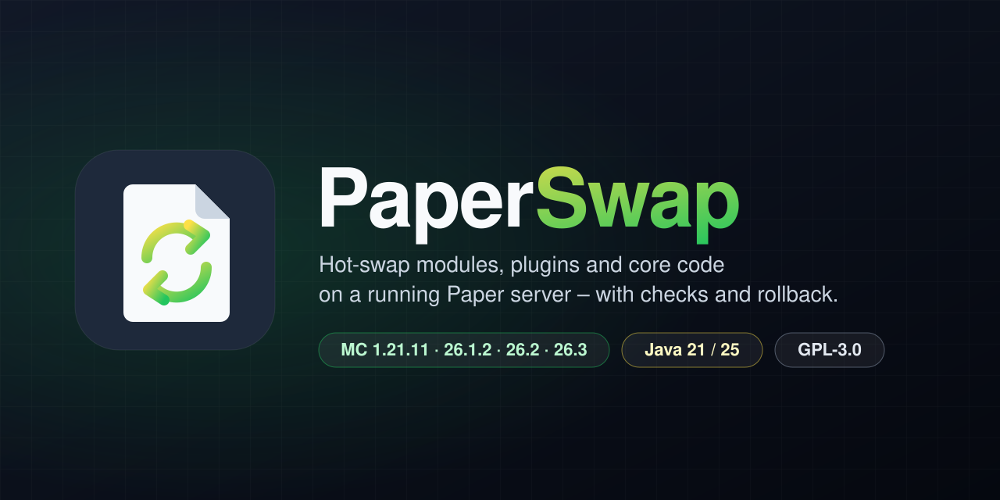
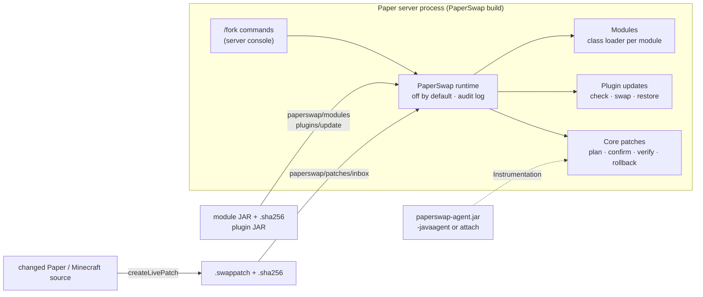

<p align="center">
  
</p>

<p align="center">
  <a href="https://github.com/luckyluci1026-stack/LemonPvP/actions/workflows/paperswap-ci.yml"></a>
  
  
  <a href="LICENSE"></a>
  
</p>

<p align="center">
  <b>English</b> · <a href="README.de.md">Deutsch</a>
</p>

---

**PaperSwap** is a fork of [Paper](https://papermc.io) for Minecraft: Java Edition that can change a
**running** server – your own modules, regular Bukkit plugins and even Paper's and Minecraft's own
code – without a restart, **where the JVM and the server can actually do it safely**. Where they
can't, PaperSwap says so and tells you to restart instead of pretending.

Out of the box it is plain Paper: the runtime is **off by default**, opens **no network port** and
does nothing until you switch it on.


### Meet Swappie

**Swappie** is our mascot: a sheet of paper caught between two swap arrows – just like the code on
your server. Swappie loves swapping, but always checks first and keeps the old version at hand.

## Highlights

- 🔁 **Hot-swappable modules** – load, enable, replace and unload extensions at runtime, each in its
  own class loader. A swap that fails rolls back to the old version; listeners, tasks, commands and
  services are tracked and released, and leaked class loaders are reported.
- 🔌 **Live plugin updates** – every Bukkit plugin update is checked first (descriptor, main class,
  class versions, dependencies, Paper plugins, lifecycle API). Only what passes is swapped live,
  everything else gets a clear *restart required*. The previous JAR can be restored.
- 🧬 **Core patches** – change a method in Paper/Minecraft source, build a `.swappatch` archive
  (with SHA-256 sidecar) with Gradle and apply it to the live server through `java.lang.instrument`. Each patch
  is planned, confirmed at the console, **read back from the running JVM** and can be rolled back.
- 🔬 **Instrumentation toolbox** – load the agent at start-up or attach it later to a running
  server, search the ~30 000 loaded classes, inspect a class (code source, SHA-256, modifiability)
  and choose between redefinition and controlled retransformation.
- 🛡️ **Safe by default** – everything that changes code is disabled until enabled in the config
  and limited to the server console; live updates need an explicit `confirm`, and actions are
  written to an audit log.
  Production profile: only allow-listed patches; modules and patches need a matching SHA-256 sidecar.
- 🧪 **Tested on real servers** – every CI run builds all four versions, runs Paper's own test
  suite, then starts each server and drives it through its console in up to ten test scenarios.

## What PaperSwap can and cannot do

| | What | How | Limit |
|---|---|---|---|
| **Modules** | extensions written against the PaperSwap API | own class loader, hot swap with rollback | not a JVM hot swap: the module instance is replaced |
| **Plugins** | ordinary Paper/Bukkit plugins | compatibility check → unload → load new JAR → restore on failure | Paper plugins, plugins with lifecycle API or active dependants: restart only |
| **Core patches** | Paper, Minecraft and PaperSwap classes | JVM class redefinition / retransformation via `paperswap-agent.jar` | standard JVMs: **method bodies only**; structural changes need JetBrains Runtime + `-XX:+AllowEnhancedClassRedefinition` |

> [!IMPORTANT]
> There is **no universal live patching**. A rollback restores **class definitions**, not server
> state: objects, static fields, caches, threads and anything a patch already did stay as they are.
> Static initialisers do not run again. Details: [`docs/LIMITATIONS.md`](docs/LIMITATIONS.md).

## How it works



The fork itself changes very little in Paper: three one-line hooks in `CraftServer` (after plugins
are enabled, before they are disabled, before `/reload`), the runtime classes under
`dev.paperswap.runtime.*`, the server brand and two Gradle tasks for core patches. No changes to
the tick loop, networking or Paper's commands. With the runtime disabled, the hooks only read one
configuration file.

## Supported versions

| Minecraft | Paper upstream | JDK | Status |
|---|---|---|---|
| 1.21.11 | `ver/1.21.11` @ `c5eb079` | 21 | supported |
| 26.1.2 (26.1 line) | `ver/26.1.2` @ `e4e17fc` | 25 | supported |
| 26.2 | `ver/26.2` @ `58e6e45` | 25 | supported |
| 26.3 | `main` @ `6829d9e` (no Paper release tag) | 25 | in progress |

Every version is a separate build – there is no "universal JAR". Folia is not supported.
Details: [`docs/VERSIONS.md`](docs/VERSIONS.md).

## Quick start

### 1. Build a server

```bash
cd versions/26.2                                   # or 1.21.11, 26.1.2, 26.3
./gradlew applyAllPatches build createPaperclipJar # 1.21.11: createMojmapPaperclipJar
java -jar paperswap-server/build/libs/*paperclip*.jar --nogui
```

Prerequisites (JDK, network access, Git identity): [`docs/BUILDING.md`](docs/BUILDING.md).
CI builds are available as workflow artifacts (`Actions → PaperSwap CI → paperswap-<version>`).

### 2. Turn the runtime on

`config/paperswap.yml` is created on first start with `enabled: false`:

```yaml
enabled: true
allow-runtime-deploy: true   # keep this on test/development servers only
```

Restart the server once.

### 3. Hot-swap a module

```bash
cp example-greeter.jar example-greeter.jar.sha256 paperswap/modules/
```

```text
fork module list
fork module enable example-greeter
fork module reload example-greeter      # hot swap with rollback
fork module config example-greeter      # reload its configuration
fork module diagnostics example-greeter # tasks, listeners, old class loaders
fork module disable example-greeter
```

### 4. Live updates for plugins and core code

```text
fork live status                      # what is allowed, what is active
fork live scan                        # what is waiting (modules, plugins/update, patches/inbox)
fork live check <name>                # possible live? (changes nothing)
fork live update <name>               # show the plan …
fork live update <name> confirm       # … and run it
fork live rollback <name> [confirm]   # previous plugin JAR / bytecode before the patch
fork live patch verify <id>           # read the running bytecode back and compare
fork instrumentation status           # agent, JVM capabilities, warnings (e.g. exposed JDWP port)
fork instrumentation classes <filter> # search loaded classes
```

Plugin updates and core patches have their own switches (`plugin-updates.enabled`,
`live-patching.enabled`). Core patches need the agent:
`java -javaagent:paperswap-agent.jar -jar server.jar` or, on a development server,
`java -jar paperswap-agent.jar attach <pid>` (local JDK attach mechanism, same OS user, no network
port). Step-by-step guides: [`docs/LIVE-UPDATES.md`](docs/LIVE-UPDATES.md),
[`docs/INSTRUMENTATION.md`](docs/INSTRUMENTATION.md).

## Safe by default

| Default | Why |
|---|---|
| Runtime `enabled: false` | a PaperSwap build behaves like Paper until you opt in |
| `allow-runtime-deploy: false` | modules only start with the server unless you allow runtime changes |
| `paperswap.module.manage`, `paperswap.live.update` default to **nobody** | code-changing commands run from the server console only (RCON is not the console) |
| every live update = plan → `confirm` | you confirm exactly the SHA-256 that was checked |
| no folder watching, no auto-load, no downloads | nothing new runs unless an operator asks for it |
| no network port | the agent uses the JDK's local attach socket; an exposed JDWP port is reported as a warning |
| production patch profile | allow-listed patches only; the development profile needs `-Dpaperswap.livepatch.development=true` |

A hash or an allow-list does not make malicious code safe, and class-loader isolation is not a
sandbox: whoever may write to `paperswap/modules/` effectively has shell access. Threat model and
recommendations: [`docs/SECURITY.md`](docs/SECURITY.md).

## Testing

PaperSwap separates three test levels and never mixes them up in its reports:

| Level | What runs | Where |
|---|---|---|
| **Unit & integration tests** | runtime core with real module JARs compiled at test time, real class loaders, the real agent (`-javaagent`) and a dynamic-attach test with two JVM processes | Temurin 21 and JetBrains Runtime 21/25 |
| **Paper build** | `applyAllPatches` + `build` runs **Paper's own test suite** against the PaperSwap server | all four versions |
| **Live server tests** | the built Paperclip JAR is started, driven through the console and stopped: runtime off/on/restart, module lifecycle, test modules (stress, faults, leaks), PvP suite, core patches, plugin updates, structural patches on JetBrains Runtime, dynamic attach + retransformation | all four versions |

Not automated (yet): real player connections, load tests with players, proxies/ViaVersion/Geyser,
Windows/macOS. Records of every relevant CI run: [`docs/TESTING.md`](docs/TESTING.md).

## Documentation

> The in-depth documentation is currently written in **German**. English translations are very
> welcome – see [Contributing](CONTRIBUTING.md).

| Topic | File |
|---|---|
| Live updates: modules, plugins, core patches, IntelliJ → server workflow | [`docs/LIVE-UPDATES.md`](docs/LIVE-UPDATES.md) |
| JVM instrumentation: agent at start-up or via attach, class search, redefinition vs. retransformation | [`docs/INSTRUMENTATION.md`](docs/INSTRUMENTATION.md) |
| Hot deployment: architecture, flows, configuration, commands | [`docs/HOT-DEPLOYMENT.md`](docs/HOT-DEPLOYMENT.md) |
| Module format and module development | [`docs/MODULE-FORMAT.md`](docs/MODULE-FORMAT.md) |
| What needs a restart | [`docs/RESTART-REQUIREMENTS.md`](docs/RESTART-REQUIREMENTS.md) |
| Known limitations | [`docs/LIMITATIONS.md`](docs/LIMITATIONS.md) |
| Security | [`docs/SECURITY.md`](docs/SECURITY.md) |
| Building the fork | [`docs/BUILDING.md`](docs/BUILDING.md) |
| Version matrix | [`docs/VERSIONS.md`](docs/VERSIONS.md) |
| Upstream sync and new versions | [`docs/UPSTREAM-SYNC.md`](docs/UPSTREAM-SYNC.md) |
| Test modules (stress, faults, dependencies, leaks) | [`docs/TEST-MODULES.md`](docs/TEST-MODULES.md) |
| LemonPvP suite: stats, combat tag, killstreaks, scoreboard (example modules) | [`docs/PVP-SUITE.md`](docs/PVP-SUITE.md) |
| Spear attack cooldown fix for 1.21.11, applied as a live patch | [`docs/SPEAR-COOLDOWN.md`](docs/SPEAR-COOLDOWN.md) |
| Compatibility (proxies, ViaVersion, Geyser …) | [`docs/COMPATIBILITY.md`](docs/COMPATIBILITY.md) |
| Troubleshooting | [`docs/TROUBLESHOOTING.md`](docs/TROUBLESHOOTING.md) |
| Tests and results | [`docs/TESTING.md`](docs/TESTING.md) |
| Performance measurements | [`docs/PERFORMANCE.md`](docs/PERFORMANCE.md) |
| Migrating from the old name "Lemon" | [`docs/MIGRATION.md`](docs/MIGRATION.md) |
| Initial analysis: verified versions, risks | [`docs/ANALYSIS.md`](docs/ANALYSIS.md) |
| Examples (configurations, descriptor, allow-list) | [`docs/examples/`](docs/examples) |

## Repository layout

```text
runtime/            runtime (API, core, Paper adapter, agent, example module, test modules, PvP suite) – one code base for all versions
versions/<mc>/      paperweight fork per Minecraft version (pinned Paper commit + PaperSwap patches)
scripts/fork/       generators for version projects and patches
scripts/livepatch/  Gradle tasks for core patches (included in every server build)
scripts/ci/         live server tests and CI helpers
docs/               documentation
assets/             logo, Swappie mascot, banner, social preview
index.html, index.zip   website files of the LemonPvP server (not part of the fork)
```

## Contributing

Bug reports, ideas, translations and pull requests are welcome. Please read
[`CONTRIBUTING.md`](CONTRIBUTING.md) and the [Code of Conduct](CODE_OF_CONDUCT.md) first.
Security issues: please report them privately, see [`SECURITY.md`](SECURITY.md).

## License and disclaimer

PaperSwap is licensed under the **GNU General Public License v3.0** – see [`LICENSE`](LICENSE) and
[`NOTICE.md`](NOTICE.md) (parts of Paper are MIT-licensed, see [`licenses/`](licenses)).

PaperSwap is **not an official Paper project** and is not affiliated with or endorsed by PaperMC,
Mojang Studios or Microsoft. "Minecraft" is a trademark of Mojang Studios. Thanks to the
[PaperMC](https://github.com/PaperMC) team for Paper and paperweight, and to JetBrains for the
[JetBrains Runtime](https://github.com/JetBrains/JetBrainsRuntime).
